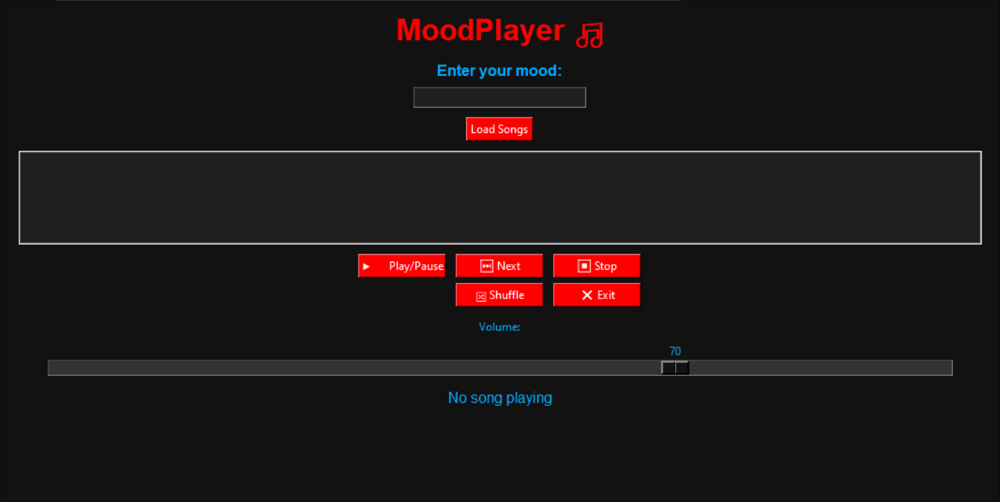
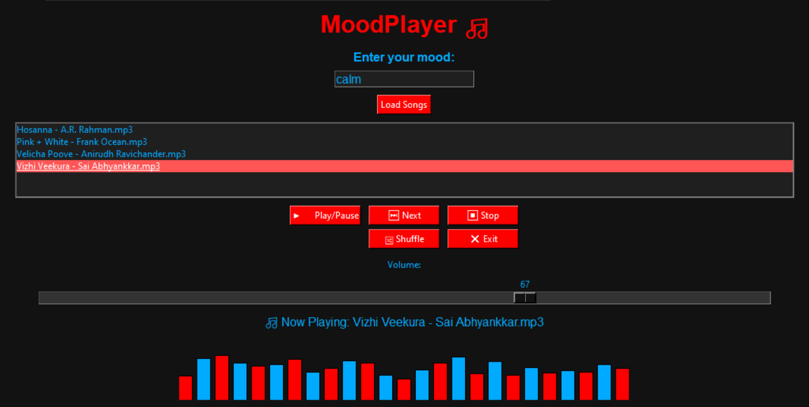

A desktop music player built with **Python, Tkinter, Pygame and MySQL**. You type in your mood (happy, sad, energetic, calm), and MoodPlayer loads the songs from the folder linked to that mood in a MySQL database and plays them with a live bar visualizer.

> CBSE Computer Science (083) Investigatory Project, Academic Year 2025 – 2026
> Author: **Kartik S**

## Screenshots

|Start screen|Playing a "calm" playlist|
|-|-|
|||

## Introduction

MoodPlayer shows how database connectivity can be used in Python through the `mysql.connector` module. MySQL stores which music folder belongs to which mood, and `pygame.mixer` plays, pauses and stops the music directly from the program. The project is a practical example of combining Python, MySQL, a GUI and audio handling to solve a real-world problem: finding music that matches how you feel.

## Objectives

* Let the user enter a mood (e.g. happy, sad, energetic, calm) and get a list of songs for that mood.
* Store the mood-to-folder mapping in MySQL so the library is flexible and database-driven. Adding a mood needs no code change.
* Play `.mp3` files chosen by the user, or from the top of the playlist, using Pygame.
* Provide a user-friendly interface with clear controls and feedback messages.
* Demonstrate modular Python programming: separate functions and classes for database access, file handling, playback and GUI.

## Features

* Mood-based playlists fetched from a MySQL database
* Play / Pause, Next, Stop, Shuffle and Exit buttons
* Real-time volume slider
* Animated visualizer with 25 bars (alternating red and blue)
* Automatically plays the next song when one finishes
* Thread-safe playback, so the window never freezes
* Clear messages when a mood or its songs are not found
* Dark themed GUI

## Modules Used

|Module|Purpose|
|-|-|
|`mysql.connector`|Connects to MySQL and fetches the folder path for a mood|
|`os`|File system operations, such as listing `.mp3` files in a folder|
|`random`|Shuffle, and small random variations in the visualizer bars|
|`pygame`|Audio playback: play, pause, stop, volume, status checking|
|`tkinter`|GUI: window, buttons, labels, entry field, slider, listbox, canvas|
|`threading`|Runs playback and the Next button in a separate thread so the GUI does not freeze|

## How It Works

1. The user types a mood and clicks **Load Songs**.
2. `get_folder_by_mood()` queries the `mood_folders` table for that mood's folder path.
3. `get_mp3_files()` lists all `.mp3` files in that folder.
4. `MusicPlayer.load_songs()` loads them into the player and the listbox shows them.
5. **Play/Pause** plays the selected song (or the first one if nothing is selected), and the visualizer starts moving.
6. The program keeps checking whether the song has ended and automatically moves to the next one.

**Main classes and functions**

* `connect_db()`, `get_folder_by_mood()`, `get_mp3_files()`: database and file handling
* `MusicPlayer`: `play`, `pause`, `stop`, `next_song`, `toggle_shuffle`, `set_volume`. All of them use `threading.Lock()` for thread safety.
* `MoodPlayerGUI`: builds the window and controls, runs the visualizer (updates every 100 ms) and the song-end check (every 500 ms)

## System Requirements

**Software**

* Python 3.x (developed on Python 3.12)
* MySQL Server, installed and running
* Libraries: `mysql-connector-python`, `pygame` (Tkinter comes with Python)
* OS: Windows, Linux or macOS

**Hardware**

* Any recent Intel or AMD processor
* At least 2 GB RAM
* Enough disk space for your music folders
* Speakers or headphones

## Installation and Setup

### 1\. Clone the repository

```bash
git clone https://github.com/<your-username>/MoodPlayer.git
cd MoodPlayer
```

### 2\. Install the libraries

```bash
pip install -r requirements.txt
```

### 3\. Create the database

Make sure MySQL is running, then run:

```bash
mysql -u root -p < setup.sql
```

This creates the `musicplayerdb` database and the `mood_folders` table with four moods:

|id|mood|folder\_path|
|-|-|-|
|1|happy|C:/Music/happy/|
|2|sad|C:/Music/sad/|
|3|energetic|C:/Music/energetic/|
|4|calm|C:/Music/calm/|

### 4\. Add your songs

Create the folders from the `folder_path` column and put your `.mp3` files inside them, sorted by mood. The folder path in the database must match the real folder on your computer. You can edit the paths in `setup.sql`, or change them later with an `UPDATE` query.

### 5\. Set your MySQL password

The program reads its database login from environment variables, so no password is stored in the code.

**Windows (PowerShell), for the current window only:**

```powershell
$env:DB_PASSWORD = "your_mysql_password"
```

**Windows, saved permanently** (close and reopen the terminal afterwards):

```powershell
setx DB_PASSWORD "your_mysql_password"
```

**macOS / Linux:**

```bash
export DB_PASSWORD="your_mysql_password"
```

Optional variables, with their defaults: `DB_HOST` (`localhost`), `DB_USER` (`root`), `DB_NAME` (`musicplayerdb`).

### 6\. Run the player

```bash
python moodplayer.py
```

## Usage

1. Enter your mood and click **Load Songs**.
2. Click a song and press **Play/Pause**. To play from the top, press **Play/Pause** without selecting anything.
3. Press **Stop** to stop playback.
4. Press **Shuffle** to switch random order on or off.
5. Press **Exit** to close the player.

## Advantages and Limitations

**Advantages**

* Makes it easy to find music that matches your mood
* Moods and playlists are managed in the database, so you do not change the code when the library changes
* Database, file handling and playback are kept in separate parts, which makes the code easier to maintain
* Plays music from your computer, so it works without internet
* Shows clear messages if something goes wrong

**Limitations**

* Needs MySQL to be set up and the login configured, which can be tricky for beginners
* Only plays `.mp3` files from the mapped folders. There is no other format support and no online streaming.
* No advanced features such as lyrics
* If a song file is missing or broken, or Pygame is not installed, music may not play
* The visualizer is an animation that scales with the volume. It does not analyse the real audio.

## Future Improvements

* Support more audio formats
* A visualizer that reacts to the actual audio (for example to the bass)
* Online streaming and lyrics
* Add or edit moods from inside the app

## Project Structure

```
MoodPlayer/
├── moodplayer.py       # Main application (database, player, GUI)
├── setup.sql           # Creates the database and mood_folders table
├── requirements.txt    # Python libraries to install
├── .gitignore          # Files Git should not upload
├── README.md           # This file
└── screenshots/        # Images used in this README
```

## Notes

Music files are not included in this repository because they are copyrighted. Add your own `.mp3` files to the mood folders.

## References

* *Computer Science with Python*, Sumita Arora
* Python 3.12 and MySQL documentation
* Pygame documentation
* ChatGPT, Perplexity AI and Google, used for research and guidance

